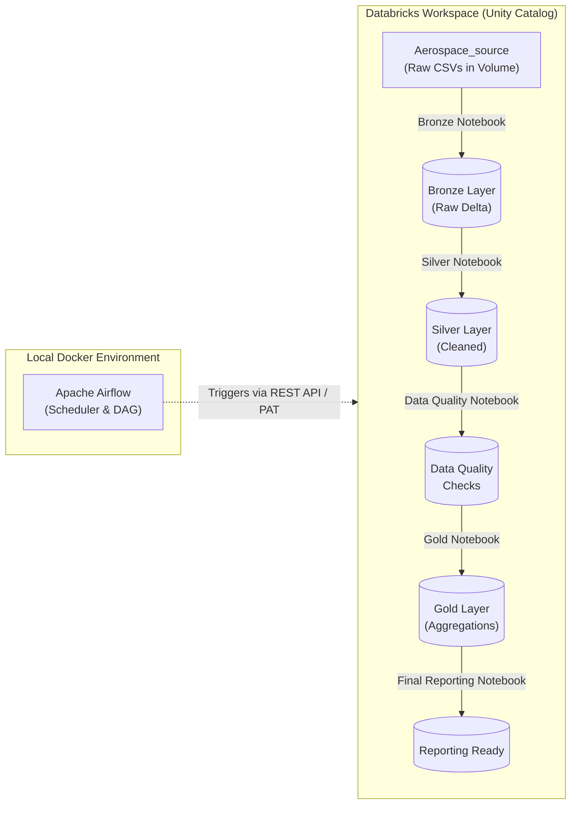

# ✈️ Aerospace Data Lakehouse Project

An enterprise-grade, end-to-end data engineering pipeline built on **Databricks**, utilizing **PySpark**, **Delta Lake**, and **Unity Catalog** to ingest, clean, validate, aggregate, and report on multi-source aerospace telemetry and operational data.

---

## 🏗️ Architecture & Notebook Structure

This project follows the **Medallion Architecture** pattern, divided into clean, modular notebooks stored in this repository:




## 📂 Repository Layout

This project is organized into modular notebooks following the Medallion Architecture pattern[cite: 5]:

* **`Aerospace_source/`** — Contains raw source datasets (`flights.csv`, `aircraft.csv`, `maintenance.csv`, `flight_sensor_data.csv`, `flight_incidents.csv`, `aerospace_flight_telemetry.csv`, `avionics_flight_displays.csv`, `cockpit_display_config.csv`)[cite: 5].
* **`Aerospace_bronze.ipynb`** — Ingests raw CSV files, infers schemas, and tags records with an ingestion timestamp into Delta tables (`workspace.default.bronze_*`)[cite: 5].
* **`Areospace_silver.ipynb`** — Standardizes formats, casts columns to proper data types (`DoubleType`, `IntegerType`, `TimestampType`), trims strings, handles nulls, and removes duplicates (`workspace.default.silver_*`)[cite: 5].
* **`Aerospace_data_quality.ipynb`** — Enforces rigorous validation rules, constraint checks, and data integrity guarantees[cite: 5].
* **`Aerospace_gold.ipynb`** — Performs advanced business-level feature engineering and multi-table aggregations (`workspace.default.gold_*`)[cite: 5].
* **`Aerospace_final_reporting.ipynb`** — Prepares final analytics-ready datasets designed to power executive summaries and monitoring dashboards[cite: 5].

---

## 🛠️ Tech Stack & Key Features

* **Processing Engine:** Apache Spark / PySpark
* **Storage Format:** Delta Lake (ensuring ACID transactions, time-travel, and reliability)
* **Data Governance:** Databricks Unity Catalog - [Managed Volumes & Delta Tables] (`workspace.default.*`)
* **Quality & Engineering Controls:**
  * Automated deduplication (`dropDuplicates`) and mandatory key validation (`dropna`).
  * Explicit type casting and string whitespace normalization (`F.trim`).
  * Auditability through tracking `ingestion_timestamp` and `processed_timestamp`.

---

## Pipeline Workflow
1. **Airflow Orchestration (Local Docker):** A scheduled Airflow DAG connects to Databricks via a Personal Access Token (PAT) and triggers the Databricks Job workflow.
2. **Bronze Layer (Ingestion):** Reads raw CSV files from the `Aerospace_source` Unity Catalog Volume and stores them as raw Delta tables with ingestion metadata.
3. **Silver Layer (Cleaning & Transformation):** Cleans null values, standardizes data types, enforces schemas, and deduplicates records.
4. **Data Quality Checks:** Validates row counts, null thresholds, and business rules before promoting data to the Gold layer.
5. **Gold Layer (Aggregations):** Builds business-level aggregations and dimensional models optimized for analytics.
6. **Final Reporting Layer:** Prepares curated, reporting-ready tables for downstream BI dashboards.

---

## Project Structure

```text
├── dags/
│   └── aerospace_databricks_dag.py   # Airflow DAG triggering Databricks Job
├── notebooks/
│   ├── 01_bronze_ingestion.py        # Raw CSV to Bronze Delta table
│   ├── 02_silver_cleaning.py         # Data cleaning & deduplication
│   ├── 03_data_quality_checks.py     # Automated validation checks
│   ├── 04_gold_aggregations.py       # Business metrics & aggregations
│   └── 05_final_reporting.py         # Reporting-ready tables
├── docker-compose.yaml               # Local Airflow Docker setup
└── README.md

```

## Setup & How to Run

### 1. Databricks Setup
1. Upload the notebooks from the `notebooks/` folder into your Databricks Workspace.
2. Upload raw aerospace CSV files into your Unity Catalog Volume (`Aerospace_source`).
3. Create a **Databricks Workflow Job** chaining the 5 notebooks in sequence (`Bronze -> Silver -> Data Quality -> Gold -> Final Reporting`) and copy the **Job ID**.
4. Generate a **Personal Access Token (PAT)** under **User Settings > Developer > Access Tokens**.

### 2. Local Airflow Setup (Docker)
1. Start Apache Airflow locally using Docker Compose:
   ```bash
   docker-compose up -d
   ```
2. Open the Airflow UI at `http://localhost:8080`.
3. Configure the Databricks connection under **Admin > Connections**:
   * **Connection Id:** `databricks_default`
   * **Connection Type:** `Databricks`
   * **Host:** `https://<your-databricks-workspace-url>`
   * **Password / Token:** `<your-databricks-pat>`
4. Update the `job_id` in `dags/aerospace_databricks_dag.py` and unpause the DAG to run the pipeline.

---
